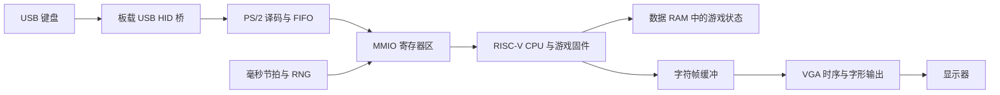
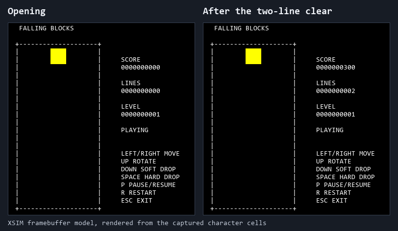

# 基于 RISC-V 与 Nexys4 DDR 的俄罗斯方块

华中科技大学《硬件综合训练》团队项目，2026 年秋季学期。

软件版本 `8425e14`，CPU 与接口基线 `ee83409`

## 摘要

本项目以 Nexys4 DDR 和团队的五级流水线 RISC-V 处理器为平台，设计具有字符显示及外接键盘控制的俄罗斯方块。游戏规则由 RV32 汇编实现，使用内存映射寄存器获取节拍、键盘字节和随机数，通过字符帧缓冲输出棋盘与分数。软件使用 RARS 检查规则和驱动，再由真实 CPU RTL 执行固件镜像进行行为仿真。已验证单至四行结算、暂停与恢复、顶部判负、重开和复位。VGA 与键盘硬件的集成及整机实测将在团队完成接线后记录。

## 1. 目标与团队分工

课程团队任务要求把处理器、外设和软件接成可演示的系统。游戏需要持续读取键盘，将方块运动、碰撞、重力和消行结果显示到 VGA。同时要能独立检查总线、显示和键盘，以便联调时定位故障。

| 成员 | 负责内容 | 报告需要补入的材料 |
| --- | --- | --- |
| 组长 | CPU、旁路与中断、MMIO 译码、顶层集成 | 最终 CPU 与译码图、关键时序、集成提交及实现结果 |
| 成员 B | PS/2 接收与 FIFO、VGA 时序及帧缓冲、时钟和板级调试 | FIFO 和显存电路图、时钟方案、板级验证和 ILA 记录 |
| 成员 C | RV32 汇编游戏、RARS 原型、驱动和诊断、镜像构建、演示和记录 | 游戏算法、回归证据、镜像版本、演示步骤及整机结果汇总 |

## 2. 系统数据通路

CPU 从独立指令 ROM 取指，上电代码将方块、计分、颜色和文字数据写到数据 RAM，并从 `sp=0x8000` 向下使用栈。软件用 `SYS_ID=0x43505556` 核对基础 MMIO，再建立游戏初始状态。寄存器区用字访问，帧缓冲位于 `0xFFFF1000–0xFFFF22BF`，由 80×30 个 16 位字符格组成。 [仓库接口约定](../../../INTERFACE.md)

### 键盘输入

Nexys4 DDR 的 USB HOST 口由板载微控制器把键盘输入转换为 PS/2。FPGA 侧接收扫描码并置入 FIFO。固件先读 `KEY_STATUS`，确认有数据后用一次 `lw` 从 `KEY_DATA` 取一字节。解码器保留 `E0` 扩展和 `F0` 松开前缀，区分方向键、按下和释放。方向动作每帧取最后一个，暂停、硬降等离散动作处理长按去重并排队。溢出时重置解析状态并排空 FIFO，随后恢复接收。 [Digilent Nexys4 DDR 参考手册](https://digilent.com/reference/_media/reference/programmable-logic/nexys-4-ddr/nexys4ddr_rm.pdf) · [PS/2 解码实现](../stage2/ps2.s)

### 显示输出

每个字符格的低八位保存字形码，高八位保存前景和背景颜色。一个棋盘格对应两个横向字符，用同一个 32 位写操作更新。固件把已锁定棋盘和活动块合成到 RAM，逐格比较上次已绘状态，只写有变化的字符对。分数、行数、等级及模式分别缓存。启动和重开时重画边框和帮助文字。 [绘制实现](../stage3/render.s)

## 3. 游戏算法

棋盘为 10×20 的字节数组，0 为空，1–7 表示已锁定方块。活动块保留形状、朝向和坐标，七种形状的四个朝向由表驱动。尝试移动或旋转时，逐格检查边界与已锁定区域，全部合法才更新姿态。硬降重复尝试向下到达最后一个合法位置，随即锁定。

锁定后从底部向上检查满行，将要保留的行从下向上压紧，并清空上方剩余行。消除一、二、三、四行分别获得 100、300、500、800 分乘结算前等级。累计每 10 行升一级。下落间隔由 Lv1 的 800 ms 每级减少 60 ms，最低 80 ms。新方块出生位置发生碰撞时，状态切换为 `GAME OVER`。

主循环读取毫秒计数，按 16、17、17 ms 调度逻辑帧，轮询键盘、推进规则、刷新画面。时间差采用 32 位无符号运算，可跨计数器回卷。暂停期间棋盘保持，恢复后从当前时刻重新计时。正式镜像通过硬件 RNG 取模选块。演示镜像固定选择 O，便于队友重复演示双行消除。 [游戏核心](../stage1/game.s) · [固件入口](../stage3/firmware.s)

## 4. 构建、联调与实测

构建脚本从课程 RARS 导出指令字，按每行一个 32 位十六进制字生成 ROM。启动数据用汇编存储指令初始化。当前 CPU 的 `LUI` 在写回阶段选择立即数，紧邻依赖可能从早期旁路读到不同值。构建代码对受影响位置安排指令间距，固件的 RNG 取模使用 `DIVU/MUL/SUB` 以适配当前内核。 [启动自检测试台](../stage0/stage0_tb.sv) · [构建与验证说明](../README.md)

RARS 通过 8 组游戏与 4 组驱动测试。真实 CPU 和基础 MMIO RTL 已通过系统 ID、拨码 LED、数码管寄存器和节拍测试。CPU 搭配字符帧缓冲与 PS/2 FIFO 模型后，通过显示、按键、正式游戏和固定 O 演示四组仿真。五份镜像重复构建哈希一致。正式游戏双行消除测得 9,116 个 CPU 周期，预置棋盘四行消除测得 9,442 个周期，最长已测样本为 15,026 周期。在候选 2 MHz 下估算分别为 4.56、4.72 和 7.51 ms。 [测试报告](测试报告.md)

图 1　固定 O 方块演示的仿真画面。第五个方块落定后，行数从 0 变为 2，等级保持 1，分数增加到 300。

整机验证待补。组长提供最终集成提交、实现时序和位流，B 提供输入与显示的板级记录，C 汇总按键、计分、状态切换及连续 5 分钟游玩的结果。 [上板验收清单](上板验收清单.md)

## 5. 小结

软件已实现可单独回归的规则核心、面向 MMIO 的硬件驱动及独立诊断程序。正式和演示固件共用状态机与绘制流程。下一步用最终硬件验证显示、输入、时钟和连续运行，并把板级结果纳入团队定稿。 [交付入口](README.md)
