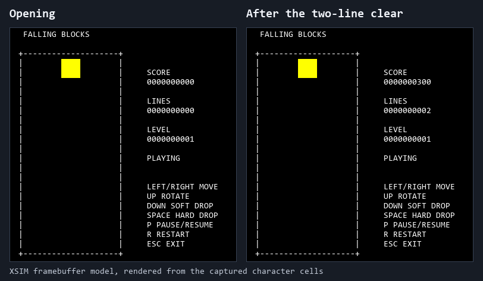

# FPGA 俄罗斯方块软件测试报告

2026-11-26。软件提交 `8425e14`，CPU 与 MMIO 基线 `ee83409`。软件回归使用课程 RARS `f0c874c` 和 Java 8u471，行为仿真使用 Vivado Simulator 2018.3。基线含真实的 CPU 和基础 MMIO RTL。显示与键盘通过测试台的帧缓冲和 FIFO 模型接入。

## 测试结果

| 测试环境与步骤 | 预期 | 实测 |
| --- | --- | --- |
| 第 0 阶段，运行 RARS 启动自检，并用 CPU RTL 启动 `stage0.mem` | PC 从零取指，栈初值为 `0x8000`，RAM 与系统 ID 自检成功 | 通过，读取预期 RAM 数据，LED 从 MMIO 输出 `600D`。 |
| RARS 游戏回归，检查 7 种方块、4 个朝向、移动、计时和消行 | 合法姿态可达，墙与堆叠阻挡越界。各消行数计分正确、等级按行数推进 | 8 组通过。覆盖 28 组坐标、单至四行、分隔满行、节拍跨零和整局复演。 |
| RARS 驱动回归，注入 PS/2 字节，读写字符格 | 松开码去重，队列绕回和溢出后恢复，字符地址与半字顺序正确 | 4 组通过。 |
| CPU＋原有 MMIO RTL，运行 `diag_mmio.mem`，切换拨码 | 读到系统 ID，LED 镜像拨码，段码测试值与递增节拍可见 | 通过。读到 `0x43505556`，数码管寄存器为 `12345678`，真实分频节拍读到 1、2。 |
| CPU＋字符帧缓冲模型，运行 `diag_vga.mem` | 一次 `sw` 更新相邻字符，`sh` 保留邻格，跨行与末格准确 | 通过。验证最后半字 `0xFFFF22BE`。在模型的互斥译码下没有误写数码管。 |
| CPU＋FIFO 模型，运行 `diag_key.mem` | 左键按下回显 `E0 6B` 和逻辑 `01`。松开回显 `E0 F0 6B`，逻辑位留空 | 通过。只在非空时读取，一次 `lw` 弹出一字节，溢出读清后下一次右键回显 `02`。 |
| CPU＋接口模型，运行 `game.mem`，控制节拍和 RNG | 方向、硬降、暂停和重开生效。双行 300 分，四行 800 分，复位可重进 | 通过。覆盖操作提示、RNG 选块、计时回卷、顶部判负、退出与复位。四行场景使用预置棋盘，保留格下移正确。 |
| CPU＋接口模型，运行 `game_demo.mem`，将模型 RNG 固定为 0 | 演示镜像仍连续生成 O，5 块铺满底部两行并计 300 分 | 通过。游戏画面和操作提示与状态一致，继续堆叠可判负，重开清零。 |
| Nexys4 DDR，最终 RTL 及实际键盘和显示器 | MMIO、VGA、PS/2 及游戏均可重复验收，连续运行 5 分钟 | 待实板。主线尚无已接入的 VGA 与 PS/2，最终位流和板上记录待补。 |

[启动自检、游戏和驱动复验入口](../README.md) · [本次回归输出](验证证据/回归输出.txt)

## 刷新耗时

测试台以 CPU 总线上的逻辑帧事务计算周期数。换算采用候选 2 MHz，显存与 FIFO 由即时响应的接口模型提供。

| 已测路径 | CPU 周期 | 显存写次数 | 2 MHz 换算 |
| --- | ---: | ---: | ---: |
| 双行消除 | 9,116 | 34 | 4.56 ms |
| 预置棋盘四行消除 | 9,442 | 84 | 4.72 ms |
| 已测最慢帧，包含重开 | 15,026 | — | 7.51 ms |

上板后在验收清单中记录实际时钟、可见按键响应、连续游玩现象和可取得的 ILA 数据。 [上板验收清单](上板验收清单.md)

## 交付镜像

两个独立输出目录的五个镜像按 SHA-256 比较，结果一致。正式和演示镜像都可装入 4096 字的指令 ROM。每行一个 32 位十六进制指令字，第一行对应 PC=0。

| 镜像 | 指令字 | SHA-256 |
| --- | ---: | --- |
| [diag_mmio.mem](镜像/diag_mmio.mem) | 260 | `5748D16804D13AD79F5A633A859B30B1EE5C2C9C24C6A74D4DA3DE97B755861A` |
| [diag_vga.mem](镜像/diag_vga.mem) | 281 | `F091D8513DC4A09D7D9EB8879531C83A30E87525E2F5C32FC0BAB42EFA67D4FD` |
| [diag_key.mem](镜像/diag_key.mem) | 281 | `FDC3931BF7B723E34828D397AFB53E5CE175B6BB1D773456215E3A238A2FB07B` |
| [game_demo.mem](镜像/game_demo.mem) | 1301 | `4BFF9DFEC872023BBA75B22CAC08C152CED4C1CFFA351C6094EF34D161BDBE0D` |
| [game.mem](镜像/game.mem) | 1300 | `E5F4804287288AA2272CD2113554DAA8CC034B27A139429B77885C8AD2A67723` |

图由 XSIM 导出的 80×30 字符帧缓冲渲染，采用接口约定的颜色和本机等宽字体，裁去空白区。左图为初始状态，右图的分数和行数对应第五块落定后的状态。 [帧缓冲导出命令](../README.md)
